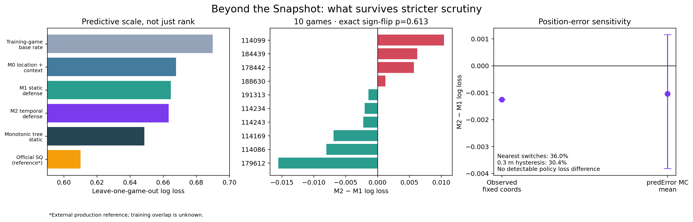
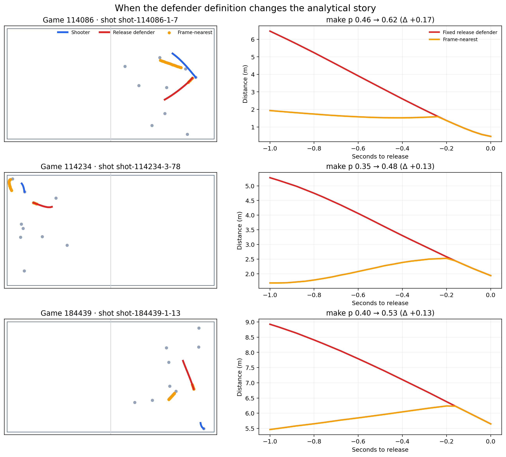

# Beyond the Snapshot

**When does temporal defensive context improve basketball shot quality?**

This open study tests a tempting tracking-data claim: that the defender's movement before release predicts shot outcome better than the release snapshot alone. It uses all ten complete 25 Hz professional games in SkillCorner Open Data Basketball, strict leave-one-game-out (LOGO) validation, small-cluster inference, position-error propagation, and possession-level case studies.



## Result

Of 1,459 shots, 1,433 have usable shooter–defender trajectories and 1,211 non-fouled shots pass a 5 cm event/tracking alignment audit. Adding one second of closing speed, separation gain, pressure duration, and distance history changes mean LOGO log loss from 0.6646 to 0.6633. The improvement is small and uncertain: Δ = −0.00125, game-cluster 95% interval [−0.00586, 0.00316], exact two-sided sign-flip p = 0.613.

The original unconditional permutation looked favorable, but it broke the relationship between temporal variables and release distance. After cross-fitted residualization on static/context features, 15.5% of within-game conditional permutations perform at least as well as observed. Nested tuning and a monotonic nonlinear tree reach the same substantive conclusion: this sample cannot resolve the small observed increment from zero.

The most actionable analysis is definitional. A frame-wise “nearest defender” changes identity during 36.0% of one-second windows. This is a quantified sensitivity—not a claim that practitioners are unaware of switching, and not evidence that switching causes prediction differences. The study also tests a 0.3 m hysteresis policy and compares all policies on an identical held-out cohort.



SkillCorner Shot Quality has mean log loss 0.6101, numerically stronger than the open models. It is treated only as an external production reference: its training size, features, and possible overlap with these games are unknown, so this is not a fair head-to-head model comparison.

## Why this matters

This is not a new proprietary-looking pressure score. It is a reproducible audit of how tracking definitions change the quantity being measured. Inverting the exact sign-flip test gives a 95% compatible location interval of [−0.00690, 0.00428] for M2−M1 log loss. The study is therefore inconclusive at an operational reference of 0.005: it cannot rule out an improvement as large as roughly 0.0069. The 0.005 reference is retrospective and is not presented as preregistered.

The repository contributes:

- release-frame event/tracking alignment checks;
- fixed-release and frame-nearest defender trajectories;
- exact sign-flip and conditional-residual permutation inference;
- nested LOGO tuned logistic and monotonic tree benchmarks;
- Monte Carlo propagation of `predError` under a documented sensitivity assumption;
- replay-ready possession tables and three defender-policy case studies;
- an importable `audit_game()` API plus the `sc-basketball` command-line interface.

## Reproduce

Python 3.10+ is required. The raw files are intentionally not committed. Download the official data version pinned in `datasets.lock.json`, then:

```bash
python -m venv .venv
source .venv/bin/activate
pip install -e '.[dev,analysis]'
./scripts/reproduce_all.sh
```

The full run executes tests, rebuilds all cohorts and models, performs 200 conditional permutations and 200 position-error Monte Carlo draws, renders figures, and validates release invariants. For a fast software check:

```bash
pytest -q
python scripts/validate_release.py
```

Reusable CLI examples:

```bash
sc-basketball validate-shots TRACKING.jsonl.gz EVENTS.json \
  --game-id GAME_ID --output-dir audit

sc-basketball build-shot-features TRACKING.jsonl.gz EVENTS.json \
  --game-id GAME_ID --window-seconds 1 \
  --defender-mode frame_nearest --output features.csv

sc-basketball audit-game TRACKING.jsonl.gz EVENTS.json \
  --game-id GAME_ID --output-dir audit_bundle
```

The same audit is importable without project scripts:

```python
from skillcorner_basketball import AuditConfig, audit_game

audit = audit_game(
    "tracking.jsonl.gz", "dynamic_events.json", game_id="GAME_ID",
    config=AuditConfig(window_seconds=1.0, defender_switch_margin_m=0.3),
)
audit.write("audit_bundle")
```

## Study map

- [Full report](reports/final_report.md)
- [Cup abstract and 60-second script](reports/analytics_cup_submission.md)
- [Robustness results](reports/robustness_results.md)
- [Data contract](docs/data_contract.md)
- [Literature gap matrix](docs/literature_gap_matrix.md)
- [Evaluation protocol](docs/evaluation_protocol.md)
- [NBA portfolio brief](reports/nba_portfolio_brief.md)

## Interpretation and limits

The result does **not** show that defensive motion is irrelevant. It shows that these simple summaries, with this public sample, do not earn a stable incremental-performance claim. Binary outcomes are noisy; only ten full games are public; broadcast-derived tracking contains extrapolated positions; orientation, contest height, tactical assignment, screens, and player effects are incompletely observed. Subgroup analyses are exploratory.

`predError` is documented as a 90% radial bound, not a Gaussian standard deviation. Monte Carlo sensitivity explicitly assumes independent isotropic Gaussian x/y error and converts the radius using `sigma = predError / sqrt(-2 log(0.1))`. It is an assumption audit, not a claim about SkillCorner's proprietary error distribution.

## License and attribution

Code is released under the [MIT License](LICENSE.md). Data remains governed by SkillCorner's terms and is not redistributed. This independent project is not affiliated with or endorsed by SkillCorner, PySport, the ACB, or any team.
