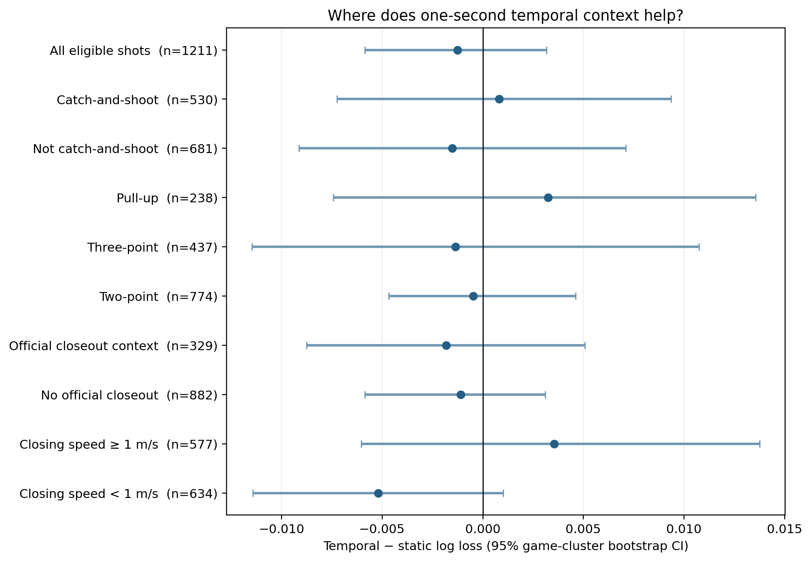

# Basketball-context analysis

## Result

No examined basketball subgroup produces a game-clustered 95% interval that excludes zero. The analysis includes catch-and-shoot, non-catch-and-shoot, pull-up, three-point, two-point, official-closeout, and closing-speed contexts.

Selected estimates:

| Context | Shots | Temporal − static log loss | 95% interval |
|---|---:|---:|---:|
| Catch-and-shoot | 530 | +0.00082 | [−0.00724, 0.00935] |
| Pull-up | 238 | +0.00326 | [−0.00743, 0.01355] |
| Three-point | 437 | −0.00136 | [−0.01147, 0.01073] |
| Official closeout context | 329 | −0.00182 | [−0.00876, 0.00508] |
| Closing speed ≥ 1 m/s | 577 | +0.00354 | [−0.00603, 0.01376] |
| Closing speed < 1 m/s | 634 | −0.00519 | [−0.01143, 0.00101] |

These are exploratory subgroup results. The closing-speed split is especially vulnerable to post-selection interpretation and should not be presented as a confirmed interaction.

## Smoothing sensitivity

A five-frame centered median was applied independently to shooter and fixed-defender coordinates before constructing temporal summaries. Release distance remained raw so that event/tracking alignment and the static baseline did not change.

The smoothed temporal-minus-static log-loss difference is **−0.00114**, with a 95% game-cluster bootstrap interval of **[−0.00563, 0.00314]**. This is nearly identical to the unsmoothed result of −0.00125. The principal conclusion is therefore not driven by single-frame coordinate jitter.

## Basketball interpretation

The current feature set summarizes only shooter–defender separation. It does not yet represent help-side geometry, screen navigation, shooter orientation, defender-to-rim angle, or whether the closeout takes away a specific shooting hand. The absence of a stable gain should therefore be interpreted as a boundary of this simple representation—not evidence that dynamic defense is unimportant.
