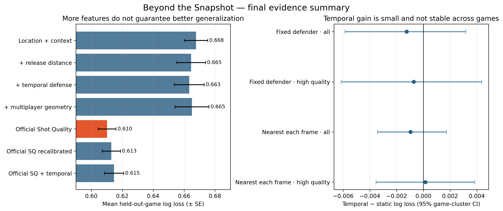

# Beyond the Snapshot

## Evaluating the reliability and incremental value of temporal defensive context in professional basketball

## Abstract

Basketball shot-quality analyses often represent defense using the nearest defender at release. Tracking data makes richer temporal descriptions possible, but additional motion variables may be noisy, unstable across games, or redundant with mature proprietary models. This study uses the ten complete 25 Hz professional games in SkillCorner Open Data Basketball to test whether 0.5-, 1-, and 2-second pre-release defensive histories improve out-of-game shot-outcome probabilities beyond location, shot context, and release distance. The study explicitly audits event/tracking alignment, compares fixed and frame-wise-nearest defender definitions, propagates the analysis through high-quality tracking subsets, applies trajectory smoothing, uses within-game permutation controls, and benchmarks against SkillCorner Shot Quality.

Among 1,459 shots, 1,433 had usable shooter–defender trajectories and 1,211 non-fouled shots met the primary event/tracking alignment rule. A one-second temporal model improved mean leave-one-game-out log loss from 0.6646 to 0.6633, but its paired game-cluster 95% interval crossed zero (difference −0.00125, 95% interval [−0.00586, 0.00316]). The result remained inconclusive under alternative defender definitions, high-quality tracking filters, smoothing, and basketball-context subgroups. Correctly aligned temporal features nevertheless outperformed 97.5% of within-game permutation controls, indicating shot-specific temporal signal without stable operational gain. A larger multiplayer geometry model generalized worse, while official SkillCorner Shot Quality was substantially stronger (mean log loss 0.6101). Adding the study’s temporal summaries to the official score did not improve it.

The main contribution is therefore a reproducible reliability result: simple temporal separation summaries contain information, but more tracking-derived features do not automatically produce robust cross-game improvement. Defender identity, event alignment, tracking quality, and external benchmarking materially change the interpretation.

## Research questions

1. Does temporal defensive context improve shot-outcome probability estimates beyond a release-time snapshot?
2. Which history window—0.5, 1, or 2 seconds—generalizes best to unseen games?
3. Are results robust to defender definition, tracking quality, trajectory smoothing, and basketball context?
4. Does temporal information add value beyond SkillCorner’s official Shot Quality benchmark?

## Data and cohort construction

The source is SkillCorner Open Data Basketball at the commit recorded in `datasets.lock.json`. Tracking is sampled at 25 Hz. Dynamic Events provide shot frames, shooter and defender identities, outcomes, context fields, and official Shot Quality.

Data audit:

- 10 professional games;
- 1,459 shot events;
- 1,433 shots with a usable shooter–defender release trajectory;
- 26 shots missing the official release defender in tracking;
- 80 shots with an official/recomputed release-distance discrepancy above 0.05 m;
- 1,211 non-fouled, aligned shots in the primary cohort;
- 44.9% made-shot rate.

The 0.05 m rule is an alignment check, not a claim about the absolute accuracy of broadcast tracking. `predError` is retained as a vendor-provided 90% error radius and is not treated as a Gaussian standard deviation.

## Models

- **M0 — location/context:** shot distance, shot clock, two/three-point status, catch-and-shoot, prior dribbles, region, and shot type.
- **M1 — static defense:** M0 plus defender distance at release.
- **M2 — temporal defense:** M1 plus recent closing speed, separation gain, pressure duration, and distance summaries.
- **M3 — multiplayer geometry:** M2 plus second/third defender distances, defensive density, defender-to-hoop angle, shooting-lane obstruction, teammate spacing, help-defender closing, and density change.
- **M4 — official recalibrated:** a logistic recalibration of official SkillCorner Shot Quality.
- **M5 — official plus temporal:** official Shot Quality plus the M2 temporal summaries.

M0–M5 use regularized logistic regression and fold-local preprocessing. The goal is controlled comparison and probability estimation, not architecture novelty.

## Validation

Every learned prediction is generated by leave-one-game-out validation. Preprocessing is fitted only on the nine training games. Primary metrics are log loss and Brier score, with AUC and calibration as secondary diagnostics. Differences are paired by held-out game and uncertainty is estimated with 20,000 game-cluster bootstrap resamples.

## Results

### Static and temporal comparison

| Model | Mean log loss | Mean Brier | Mean AUC |
|---|---:|---:|---:|
| M0 location/context | 0.6677 | 0.2369 | 0.6216 |
| M1 static defense | 0.6646 | 0.2356 | 0.6310 |
| M2 temporal, 0.5 s | 0.6647 | 0.2356 | 0.6290 |
| M2 temporal, 1.0 s | **0.6633** | **0.2350** | **0.6333** |
| M2 temporal, 2.0 s | 0.6666 | 0.2364 | 0.6291 |

One second is the strongest tested temporal window. Two seconds is worse than the static model, consistent with older history adding assignment changes, irrelevant movement, or noise.

The one-second improvement over M1 is small and heterogeneous: Δ log loss −0.00125, 95% interval [−0.00586, 0.00316], with improvement in six of ten games.

### Robustness

None of four defender-definition/tracking-quality combinations excludes zero. Five-frame centered-median smoothing produces Δ log loss −0.00114 [−0.00563, 0.00314], almost identical to the raw result.

Under frame-wise nearest-defender tracking, defender identity changes during the one-second history for 525 of 1,458 valid trajectories (36.0%). A metric that silently switches players is therefore not measuring the same defensive assignment as a fixed-defender trajectory.

### Negative control

Within each game, temporal feature vectors were jointly permuted across shots 200 times while static context, outcomes, and game membership remained fixed. The observed aligned result (−0.00125) was better than 97.5% of permuted runs. This supports the presence of shot-specific temporal information, but it does not override the wide between-game uncertainty.

### Basketball contexts

Catch-and-shoot, pull-up, two-point, three-point, official-closeout, and closing-speed subgroup intervals all cross zero. These exploratory comparisons provide no defensible subgroup claim.

### Multiplayer geometry

M3 produces mean log loss 0.6651, worse than both M1 and M2. The added feature block does not generalize with the current cohort and fixed regularization. This is evidence against indiscriminate feature expansion, not evidence that help defense is irrelevant.

### Official benchmark

| Model | Mean log loss | Mean Brier | Mean AUC |
|---|---:|---:|---:|
| M2 temporal defense | 0.6633 | 0.2350 | 0.6333 |
| Official Shot Quality | **0.6101** | **0.2123** | **0.7117** |
| M4 official recalibrated | 0.6129 | 0.2127 | 0.7117 |
| M5 official plus temporal | 0.6147 | 0.2135 | 0.7062 |

Official Shot Quality is decisively stronger than the open reconstruction. M2 is worse than the official benchmark in all ten games, with Δ log loss +0.0532 [0.0365, 0.0697]. Adding the simple temporal block to the official score does not improve it.

## Interpretation

The study supports three conclusions:

1. Release-time defender distance adds useful information to a basic open model.
2. Correctly aligned temporal summaries contain some shot-specific signal, but their average incremental benefit is too small and heterogeneous for a stable performance claim.
3. Mature Shot Quality modeling captures substantially more information than distance histories alone; adding many geometric variables without sufficient sample size or structure can reduce generalization.

## Limitations

- Only ten complete tracking games are public.
- Outcomes are binary and intrinsically noisy; individual shooter effects cannot be estimated reliably.
- Tracking is derived from broadcast video and contains extrapolated positions.
- Official Shot Quality is a strong but not fully reconstructable benchmark, so this study evaluates it rather than claiming a like-for-like replication.
- Orientation, limb position, contest height, screen navigation, and tactical intent are unavailable.
- Subgroup analyses are exploratory and underpowered.

## Reproducibility

Source and dataset versions are pinned. Raw data is excluded from Git. Every derived result can be rebuilt with the commands in `README.md`; automated tests cover normalization, alignment, temporal features, defender switching, smoothing invariance, spatial geometry, cross-game prediction, and bootstrap direction.

## Conclusion

The practical lesson is not that temporal defense is useless. It is that tracking-derived complexity must earn its place through out-of-game validation, uncertainty analysis, and comparison with a strong external benchmark. In this dataset, the defensible contribution is a transparent boundary result and a reusable evaluation protocol—not a new universal pressure score.

## References

See `docs/literature_gap_matrix.md` for the scoped literature map and links.
