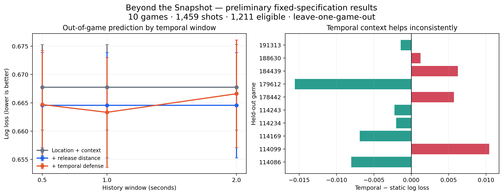

# Beyond the Snapshot — preliminary results

## Scope

This is the first fixed-specification run, not the final competition claim. It covers all 10 open professional games and compares release-time and temporal defensive context using leave-one-game-out validation.

## Cohort

- 1,459 total shots;
- 1,433 shots with shooter/defender trajectories at release;
- 26 shots missing the official release defender in tracking;
- 80 shots with official/recomputed release distance disagreement greater than 5 cm;
- 1,211 non-fouled, aligned shots in the primary modeling cohort;
- 44.9% made-shot rate in that cohort.

## First result

| Model / window | Mean log loss | Mean Brier | Mean AUC |
|---|---:|---:|---:|
| Location/context baseline | 0.6677 | 0.2369 | 0.6216 |
| + release defender distance | 0.6646 | 0.2356 | 0.6310 |
| + temporal defense, 0.5 s | 0.6647 | 0.2356 | 0.6290 |
| + temporal defense, 1.0 s | **0.6633** | **0.2350** | **0.6333** |
| + temporal defense, 2.0 s | 0.6666 | 0.2364 | 0.6291 |

The one-second temporal model improves mean log loss over the static model by 0.00125 and improves in 6 of 10 held-out games. The between-game standard deviation of that paired difference is 0.00769, much larger than the mean improvement. The correct initial interpretation is therefore **small and unstable incremental value**, not a decisive universal advantage.

The two-second model performs worse than the static model on average. This supports the substantive hypothesis that older defensive history may add noise, include assignment changes, or be poorly represented by a fixed release-defender definition.

## Why this is still valuable

The experiment rejects an easy but weak story—“more temporal data must improve shot quality.” It produces a sharper next question: under which basketball situations and data-quality conditions does the one-second history help?

## Next confirmatory work

1. quantify uncertainty for paired game-level differences;
2. compare fixed release defender with frame-wise nearest defender;
3. rerun on high-quality detected-only windows;
4. inspect large static/temporal prediction disagreements with animated possessions;
5. add coefficient stability, calibration plots, and negative controls;
6. freeze a final analysis plan before any model expansion.
