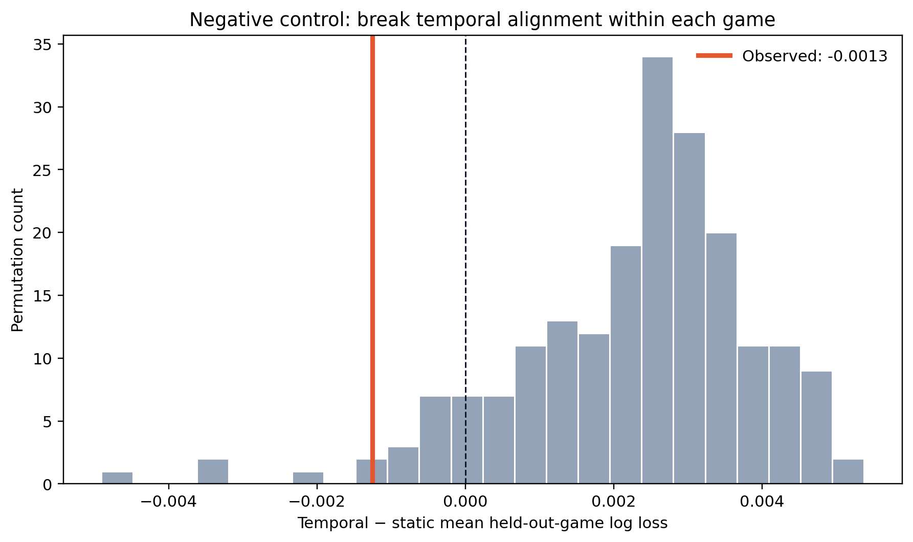

# Robustness results

## Main inference

The apparent one-second temporal improvement is not statistically stable across games. A paired cluster bootstrap over held-out games gives a temporal-minus-static log-loss difference of **−0.00125**, with a 95% interval of **[−0.00586, 0.00316]**. The interval crosses zero.

This conclusion persists under all four prespecified sensitivity conditions:

| Defender trajectory | Cohort | Shots | Δ log loss | 95% interval | Games favoring temporal |
|---|---|---:|---:|---:|---:|
| Fixed release defender | All eligible | 1,211 | −0.00125 | [−0.00586, 0.00316] | 6/10 |
| Fixed release defender | High quality | 992 | −0.00072 | [−0.00615, 0.00435] | 5/10 |
| Frame-wise nearest | All eligible | 1,209 | −0.00096 | [−0.00344, 0.00172] | 6/10 |
| Frame-wise nearest | High quality | 991 | +0.00015 | [−0.00354, 0.00383] | 6/10 |

For loss metrics, negative differences favor the temporal model.

## Defender identity is not a minor implementation detail

Under the frame-wise-nearest definition, the selected defender changes at least once during the one-second window in 525 of 1,458 valid trajectories (36.0%). A temporal metric that silently switches defenders therefore answers a different basketball question from one that follows the release defender.

## Interpretation

The current evidence supports a reliability finding rather than a performance claim:

> Simple pre-release defensive summaries do not provide a robust, general out-of-game improvement over release-time distance in this 10-game open dataset.

This does not establish that motion is irrelevant. Potential explanations include limited sample size, assignment switching, noisy derivative features, insufficient offensive context, and genuine situation-specific effects. These explanations must be tested rather than selected after seeing the result.

## Negative control

In 200 negative-control repetitions, the six temporal feature columns were jointly permuted among shots within each game. Static features, outcomes, sample sizes, and game membership were left unchanged.

- observed aligned temporal-minus-static log-loss difference: **−0.00125**;
- mean permuted difference: **+0.00227**;
- 95% permutation range: **[−0.00116, 0.00487]**;
- fraction of permuted runs as favorable as the observed alignment: **0.025**.

This creates an important but deliberately cautious distinction: the aligned temporal variables appear to contain more shot-specific information than randomly mismatched temporal variables, yet the resulting model improvement remains too heterogeneous across the ten games for its paired game-level interval to exclude zero. Evidence of temporal signal is therefore stronger than evidence of a stable operational performance gain.

## Next analysis

- inspect model-disagreement possessions rather than average effects alone;
- test smoothing and derivative stability;
- stratify by catch-and-shoot, pull-up, three-point, and closeout-event context;
- use a negative-control time shift to test whether apparent temporal signal survives broken event alignment;
- avoid a global proprietary-looking “pressure score” unless its added value is demonstrated.

The expanded basketball-context and smoothing analyses are reported in [basketball_context_results.md](basketball_context_results.md).
