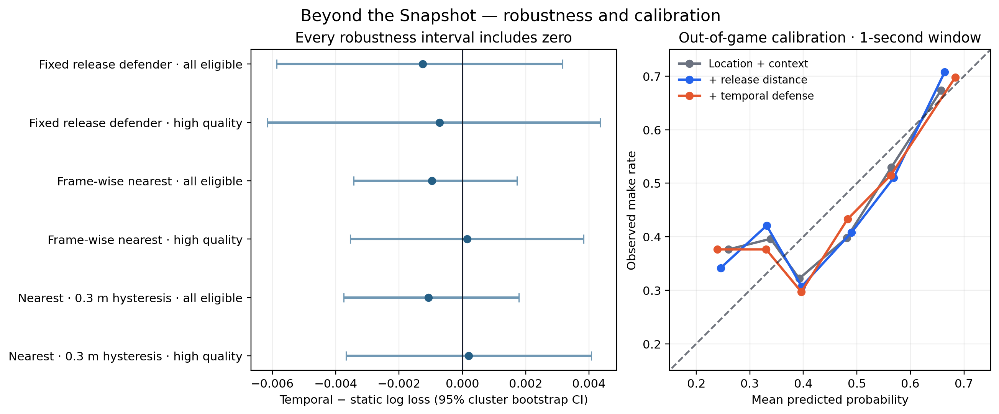
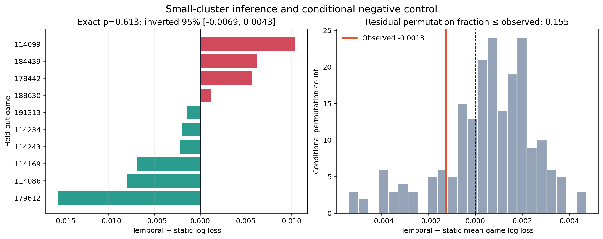
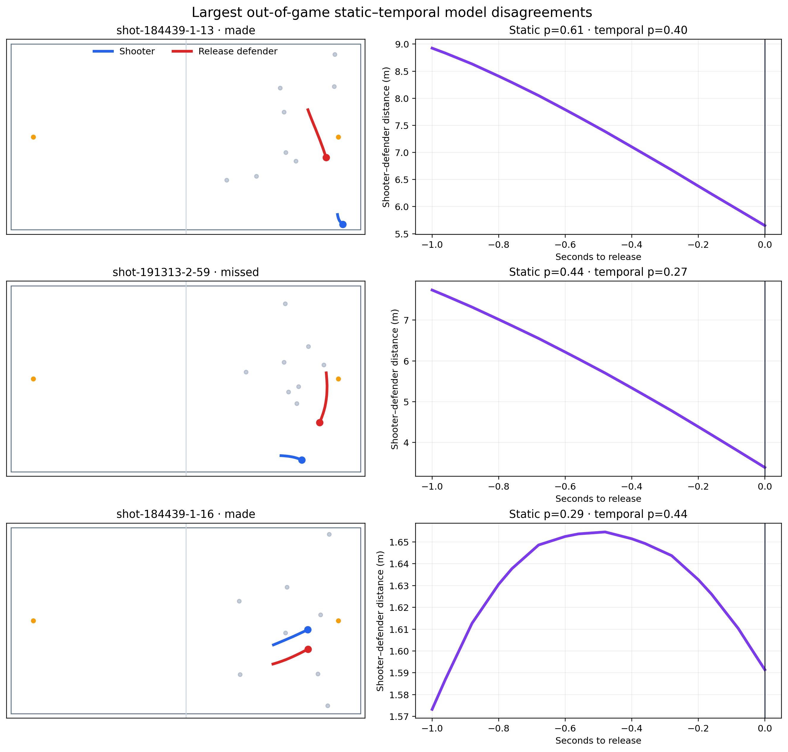

# Robustness results

## Main inference

The apparent one-second temporal improvement is not statistically stable across games. A paired cluster bootstrap over held-out games gives a temporal-minus-static log-loss difference of **−0.00125**, with a 95% interval of **[−0.00586, 0.00316]**. The interval crosses zero.

This conclusion persists across four original and two revised defender/quality conditions:

| Defender trajectory | Cohort | Shots | Δ log loss | 95% interval | Games favoring temporal |
|---|---|---:|---:|---:|---:|
| Fixed release defender | All eligible | 1,211 | −0.00125 | [−0.00586, 0.00316] | 6/10 |
| Fixed release defender | High quality | 992 | −0.00072 | [−0.00615, 0.00435] | 5/10 |
| Frame-wise nearest | All eligible | 1,209 | −0.00096 | [−0.00344, 0.00172] | 6/10 |
| Frame-wise nearest | High quality | 991 | +0.00015 | [−0.00354, 0.00383] | 6/10 |
| 0.3 m hysteresis | All eligible | 1,209 | −0.00107 | [−0.00375, 0.00179] | 6/10 |
| 0.3 m hysteresis | High quality | 988 | +0.00020 | [−0.00368, 0.00407] | 5/10 |

For loss metrics, negative differences favor the temporal model.

## Defender identity is not a minor implementation detail

Under the frame-wise-nearest definition, the selected defender changes at least once during the one-second window in 525 of 1,458 valid trajectories (36.0%). This quantifies a familiar definitional sensitivity. A release-anchored 0.3 m hysteresis policy reduces it to 436 of 1,433 valid trajectories (30.4%).

Across 1,209 common predictions, fixed and nearest policies correlate at 0.988, but the mean absolute probability difference is 0.0141 (95th percentile 0.0522), and 68 shots differ by more than five percentage points. Mean absolute difference is 0.0256 when identity switches and 0.0075 otherwise. This is an association, not a causal effect: switches concentrate in crowded, near-tie situations.

On an identical 1,209-shot cohort, mean log loss is 0.66450 fixed, 0.66472 frame-nearest, and 0.66453 with 0.3 m hysteresis. Paired game differences versus fixed are +0.00022 [−0.00304, 0.00308] and +0.00002 [−0.00327, 0.00287], respectively. No definition is detectably more accurate; the analysis establishes sensitivity of the construct, not superiority of a policy.

## Interpretation

The current evidence supports a reliability finding rather than a performance claim:

> Simple pre-release defensive summaries do not provide a robust, general out-of-game improvement over release-time distance in this 10-game open dataset.

This does not establish that motion is irrelevant. Potential explanations include limited sample size, assignment switching, noisy derivative features, insufficient offensive context, and genuine situation-specific effects. These explanations must be tested rather than selected after seeing the result.

## Small-cluster and conditional inference

The exact two-sided sign-flip test over all 2^10 assignments gives p = 0.613. This is preferred to relying only on a bootstrap percentile interval with ten clusters.

The original whole-vector permutation is now classified as a naive diagnostic because it destroys the dependence between temporal features and static release context. A stricter control first residualizes all temporal features against static/context features with cross-fitted quadratic Ridge models, then jointly permutes residual vectors within game.

- observed temporal-minus-static difference: **−0.00125**;
- conditional null mean: **+0.00052**;
- conditional 95% range: **[−0.00411, 0.00376]**;
- fraction of conditional permutations at least as favorable: **0.155**.

The earlier 0.025 fraction is not used as evidence. Under the better-matched null, this sample does not establish incremental temporal information beyond static/context features.

## Next analysis

- inspect model-disagreement possessions rather than average effects alone;
- test smoothing and derivative stability;
- stratify by catch-and-shoot, pull-up, three-point, and closeout-event context;
- use a negative-control time shift to test whether apparent temporal signal survives broken event alignment;
- avoid a global proprietary-looking “pressure score” unless its added value is demonstrated.

The expanded basketball-context and smoothing analyses are reported in [basketball_context_results.md](basketball_context_results.md).
